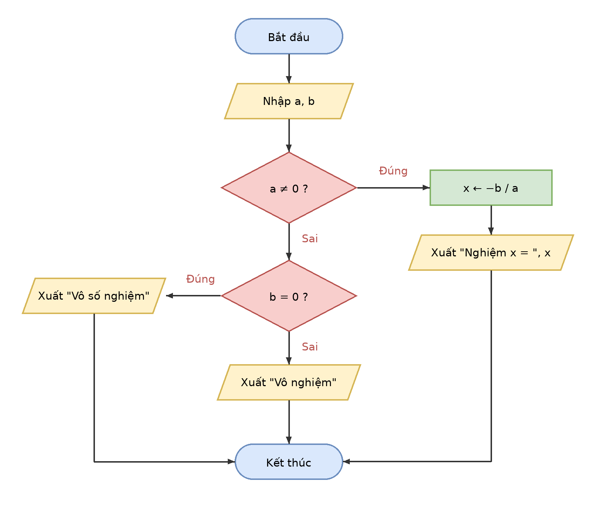

# Buoi01_A6 - Giải phương trình ax + b = 0

Sinh viên: Trần Hoàng Lam - MSSV: [31251022899]

## 1. Vào/ra
- Vào: hai số thực a, b
- Ra: nghiệm x, hoặc "Vô số nghiệm" / "Vô nghiệm"

## 2. Các trường hợp
1. a ≠ 0: phương trình có một nghiệm x = -b / a
2. a = 0 và b = 0: 0x + 0 = 0 đúng với mọi x, nên vô số nghiệm
3. a = 0 và b ≠ 0: 0x + b = 0 không bao giờ đúng, nên vô nghiệm

## 3. Mã giả
```
BẮT ĐẦU
  NHẬP a, b
  NẾU a ≠ 0 THÌ
    x ← -b / a
    XUẤT "Nghiệm x = ", x
  NGƯỢC LẠI
    NẾU b = 0 THÌ
      XUẤT "Vô số nghiệm"
    NGƯỢC LẠI
      XUẤT "Vô nghiệm"
    KẾT THÚC NẾU
  KẾT THÚC NẾU
KẾT THÚC
```

## 4. Lưu đồ


## 5. Bảng chạy tay
| a | b | a ≠ 0 ? | b = 0 ? | Kết quả xuất |
|---|---|---|---|---|
| 2 | -4 | Đúng | (không xét) | Nghiệm x = 2 |
| 0 | 0 | Sai | Đúng | Vô số nghiệm |
| 0 | 5 | Sai | Sai | Vô nghiệm |

Ba bộ dữ liệu đi qua đủ ba nhánh của lưu đồ.
