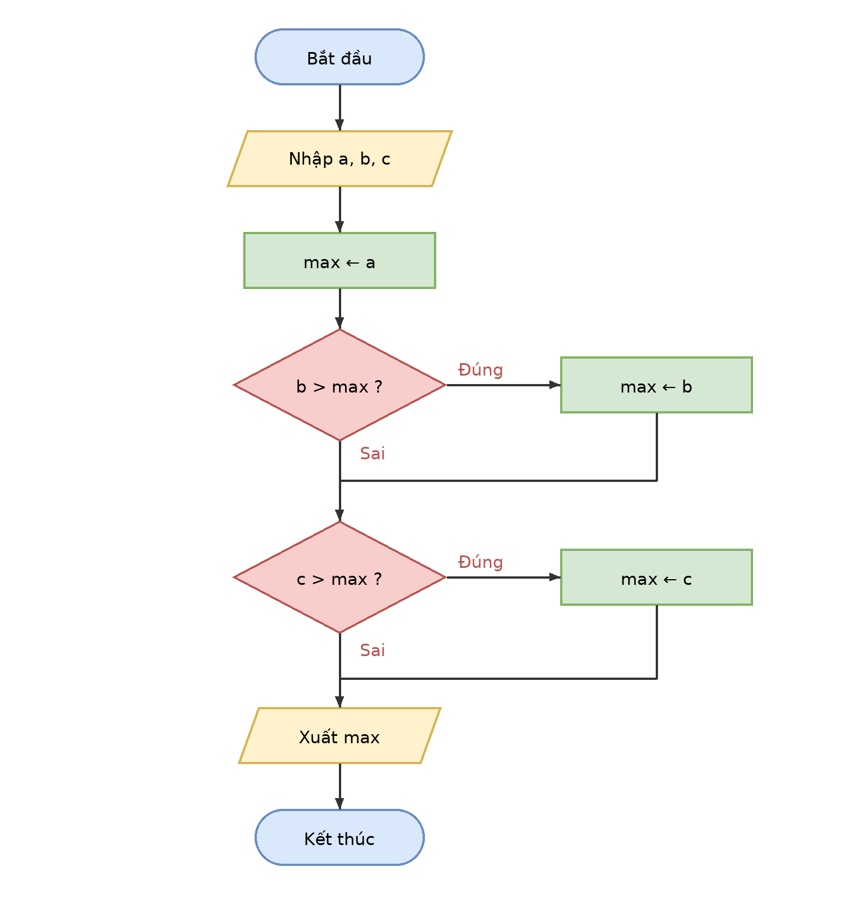

# Buoi01_B4 - Số lớn nhất trong 3 số

Sinh viên: Trần Hoàng Lâm - MSSV: [mã số]
Ngày: 20/10/2026

## 1. Vào/ra
- Vào: ba số a, b, c
- Ra: số lớn nhất max

## 2. Ý tưởng
Giả sử a là số lớn nhất, lần lượt so với b rồi c; số nào lớn hơn thì cập nhật max.

## 3. Mã giả
```
BẮT ĐẦU
  NHẬP a, b, c
  max ← a
  NẾU b > max THÌ
    max ← b
  KẾT THÚC NẾU
  NẾU c > max THÌ
    max ← c
  KẾT THÚC NẾU
  XUẤT max
KẾT THÚC
```

## 4. Lưu đồ


## 5. Bảng chạy tay
| a | b | c | max ← a | b > max ? | max sau b | c > max ? | max cuối | Xuất |
|---|---|---|---|---|---|---|---|---|
| 3 | 7 | 5 | 3 | Đúng (7 > 3) | 7 | Sai (5 > 7) | 7 | **7** |
| 9 | 2 | 9 | 9 | Sai (2 > 9) | 9 | Sai (9 > 9) | 9 | **9** |
| -1 | -5 | -3 | -1 | Sai (-5 > -1) | -1 | Sai (-3 > -1) | -1 | **-1** |

- Bộ (9, 2, 9) kiểm tra trường hợp hai số bằng nhau: dùng `>` nên max không đổi, kết quả vẫn đúng.
- Bộ (-1, -5, -3) kiểm tra trường hợp số âm.
