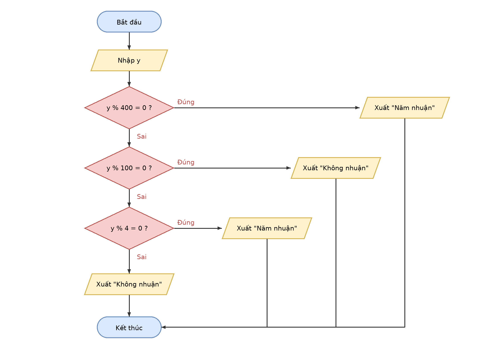

# Buoi01_B5 - Năm nhuận

Sinh viên: Trần Hoàng Lam - MSSV: 31251022899

## 1. Vào/ra
- Vào: năm y
- Ra: "Năm nhuận" hoặc "Không nhuận"

## 2. Ý tưởng
Năm nhuận là năm chia hết cho 400, hoặc chia hết cho 4 nhưng không chia hết cho 100. Thứ tự kiểm tra: chia hết cho 400 trước, rồi 100, rồi 4.

## 3. Mã giả
```
BẮT ĐẦU
  NHẬP y
  NẾU y % 400 = 0 THÌ
    XUẤT "Năm nhuận"
  NGƯỢC LẠI
    NẾU y % 100 = 0 THÌ
      XUẤT "Không nhuận"
    NGƯỢC LẠI
      NẾU y % 4 = 0 THÌ
        XUẤT "Năm nhuận"
      NGƯỢC LẠI
        XUẤT "Không nhuận"
      KẾT THÚC NẾU
    KẾT THÚC NẾU
  KẾT THÚC NẾU
KẾT THÚC
```

## 4. Lưu đồ


## 5. Bảng chạy tay
| y | y % 400 = 0 ? | y % 100 = 0 ? | y % 4 = 0 ? | Kết quả xuất |
|---|---|---|---|---|
| 2024 | Sai (dư 24) | Sai (dư 24) | Đúng | Năm nhuận |
| 1900 | Sai (dư 300) | Đúng | (không xét) | Không nhuận |
| 2000 | Đúng | (không xét) | (không xét) | Năm nhuận |
| 2026 | Sai (dư 26) | Sai (dư 26) | Sai (dư 2) | Không nhuận |

Bốn bộ dữ liệu đi qua đủ bốn nhánh kết quả.
