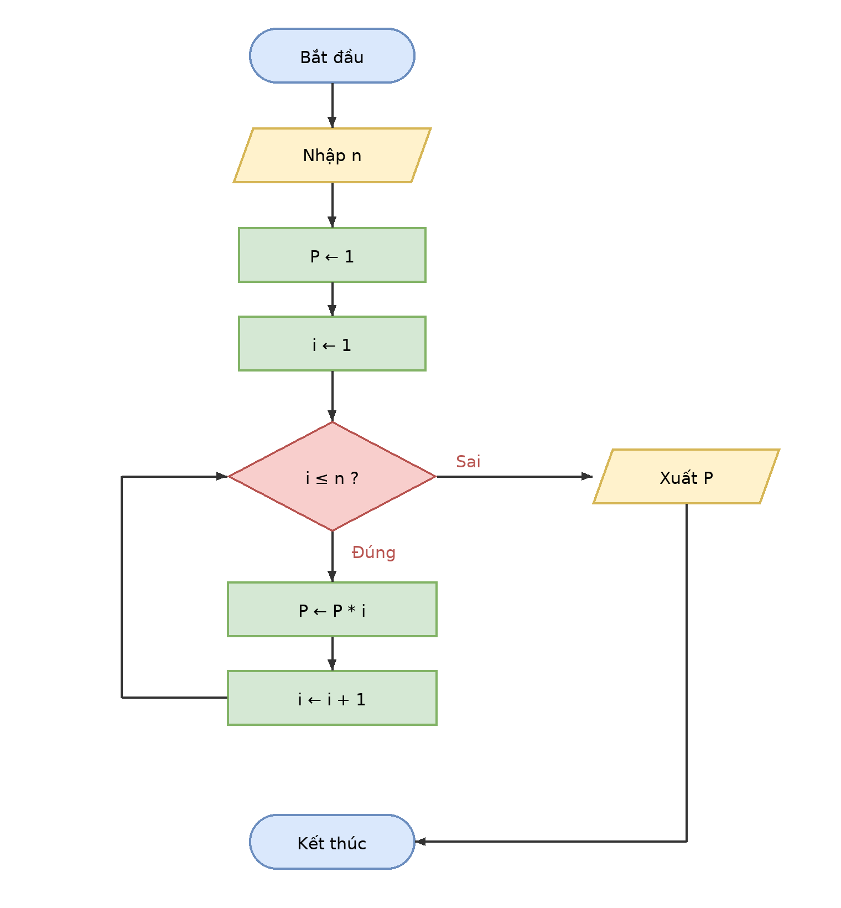

# Buoi01_B6 - Tính n!

Sinh viên: Trần Hoàng Lam - MSSV: 31251022899

## 1. Vào/ra
- Vào: số nguyên n ≥ 0
- Ra: P = n! = 1 × 2 × … × n

## 2. Ý tưởng
Giống thuật toán tính tổng 1 + 2 + … + n, chỉ khác: biến tích lũy P khởi tạo bằng 1 (không phải 0) và dùng phép nhân thay cho phép cộng.

## 3. Mã giả
```
BẮT ĐẦU
  NHẬP n
  P ← 1
  i ← 1
  TRONG KHI i ≤ n
    P ← P * i
    i ← i + 1
  KẾT THÚC TRONG KHI
  XUẤT P
KẾT THÚC
```

## 4. Lưu đồ


## 5. Bảng chạy tay (n = 5)
| Bước | i | i ≤ n ? | P sau khi nhân | i sau khi tăng |
|---|---|---|---|---|
| Khởi tạo | 1 | | 1 | |
| 1 | 1 | Đúng | 1 | 2 |
| 2 | 2 | Đúng | 2 | 3 |
| 3 | 3 | Đúng | 6 | 4 |
| 4 | 4 | Đúng | 24 | 5 |
| 5 | 5 | Đúng | 120 | 6 |
| 6 | 6 | Sai | | |

Xuất **120**, đúng vì 5! = 120.

## 6. Kiểm tra thêm n = 0
P = 1, i = 1. Điều kiện 1 ≤ 0 Sai nên vòng lặp không chạy, xuất P = **1**, đúng vì 0! = 1.
