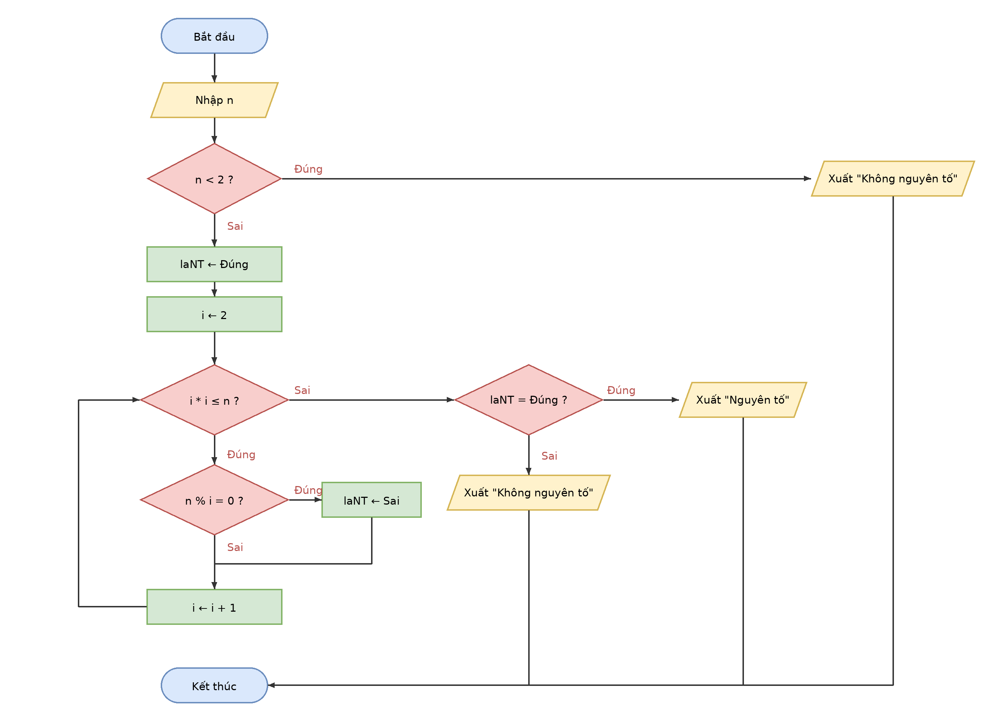

# Buoi01_B7 - Kiểm tra số nguyên tố

Sinh viên: Trần Hoàng Lam - MSSV: 31251022899

## 1. Vào/ra
- Vào: số nguyên n
- Ra: "Nguyên tố" hoặc "Không nguyên tố"

## 2. Ý tưởng
1. Xử lý trường hợp đặc biệt trước: n < 2 thì không nguyên tố.
2. Dùng biến cờ laNT ← Đúng. Cho i chạy từ 2; nếu n % i = 0 thì laNT ← Sai.
3. Sau vòng lặp, dựa vào laNT để xuất kết quả.
4. Cải tiến: chỉ cần thử khi i * i ≤ n. Vì nếu n = a × b với a ≤ b thì a ≤ √n, nên nếu n có ước khác 1 và n thì luôn có một ước nằm trong khoảng 2 đến √n.

(Bản chưa cải tiến chỉ khác ở điều kiện lặp: i ≤ n − 1.)

## 3. Mã giả
```
BẮT ĐẦU
  NHẬP n
  NẾU n < 2 THÌ
    XUẤT "Không nguyên tố"
  NGƯỢC LẠI
    laNT ← Đúng
    i ← 2
    TRONG KHI i * i ≤ n
      NẾU n % i = 0 THÌ
        laNT ← Sai
      KẾT THÚC NẾU
      i ← i + 1
    KẾT THÚC TRONG KHI
    NẾU laNT = Đúng THÌ
      XUẤT "Nguyên tố"
    NGƯỢC LẠI
      XUẤT "Không nguyên tố"
    KẾT THÚC NẾU
  KẾT THÚC NẾU
KẾT THÚC
```

## 4. Lưu đồ


## 5. Bảng chạy tay

**n = 7**

| i | i * i ≤ n ? | n % i | laNT |
|---|---|---|---|
| 2 | 4 ≤ 7 Đúng | 1 | Đúng |
| 3 | 9 ≤ 7 Sai, dừng | | Đúng |

Xuất **Nguyên tố**.

**n = 9**

| i | i * i ≤ n ? | n % i | laNT |
|---|---|---|---|
| 2 | 4 ≤ 9 Đúng | 1 | Đúng |
| 3 | 9 ≤ 9 Đúng | 0 | Sai |
| 4 | 16 ≤ 9 Sai, dừng | | Sai |

Xuất **Không nguyên tố**.

**n = 1**

n < 2 Đúng, xuất **Không nguyên tố** ngay, không vào vòng lặp.

## 6. Câu hỏi cải tiến (n = 97)
- Chưa cải tiến: i chạy từ 2 đến 96, tức **95 lần thử**.
- Cải tiến: i * i ≤ 97 nên i chạy từ 2 đến 9 (vì 9 × 9 = 81 ≤ 97, còn 10 × 10 = 100 > 97), tức **8 lần thử**.
