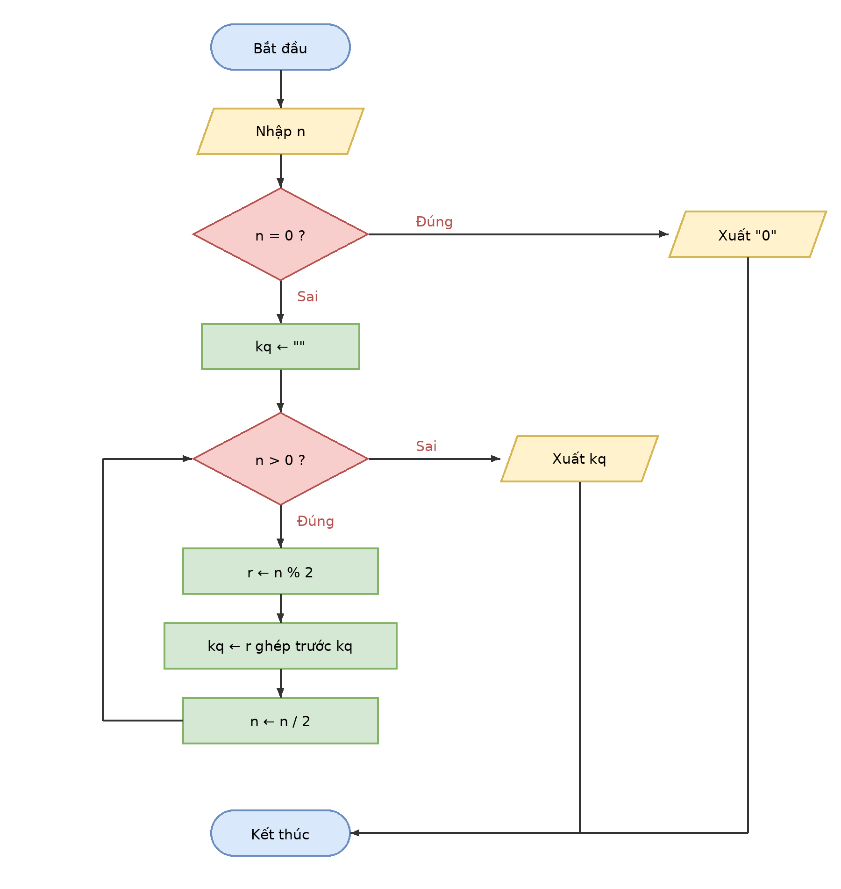

# Buoi01_B8 - Đổi số thập phân sang nhị phân

Sinh viên: Trần Hoàng Lâm - MSSV: [mã số]
Ngày: 20/10/2026

## 1. Vào/ra
- Vào: số nguyên n ≥ 0
- Ra: dạng nhị phân của n (chuỗi kq)

## 2. Làm tay trước (n = 13)
Chia liên tiếp cho 2, ghi số dư, dừng khi thương bằng 0:
- 13 : 2 = 6 dư 1
- 6 : 2 = 3 dư 0
- 3 : 2 = 1 dư 1
- 1 : 2 = 0 dư 1

Đọc số dư từ dưới lên: **1101**.

Trong thuật toán, "đọc từ dưới lên" nghĩa là mỗi số dư mới được ghép vào **bên trái** chuỗi kq. Trường hợp n = 0 xử lý riêng: kết quả là "0".

## 3. Mã giả
```
BẮT ĐẦU
  NHẬP n
  NẾU n = 0 THÌ
    XUẤT "0"
  NGƯỢC LẠI
    kq ← ""
    TRONG KHI n > 0
      r ← n % 2
      kq ← r ghép trước kq
      n ← n / 2        (chia lấy phần nguyên)
    KẾT THÚC TRONG KHI
    XUẤT kq
  KẾT THÚC NẾU
KẾT THÚC
```

## 4. Lưu đồ


## 5. Bảng chạy tay

**n = 13**

| Lần | n | n % 2 | kq (sau khi ghép) | n / 2 |
|---|---|---|---|---|
| 1 | 13 | 1 | "1" | 6 |
| 2 | 6 | 0 | "01" | 3 |
| 3 | 3 | 1 | "101" | 1 |
| 4 | 1 | 1 | "1101" | 0 |

n = 0 nên dừng. Xuất **1101**.

**n = 6**

| Lần | n | n % 2 | kq (sau khi ghép) | n / 2 |
|---|---|---|---|---|
| 1 | 6 | 0 | "0" | 3 |
| 2 | 3 | 1 | "10" | 1 |
| 3 | 1 | 1 | "110" | 0 |

Xuất **110**. Kiểm tra: 110 nhị phân = 4 + 2 = 6.

**n = 0 (trường hợp đặc biệt)**

n = 0 nên rẽ nhánh Đúng ở câu hỏi đầu, xuất "0", không vào vòng lặp.
